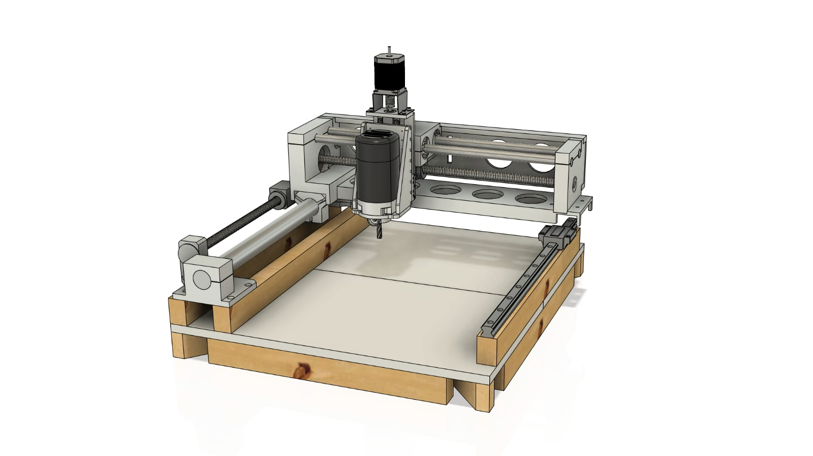

# CNC02 - LinuxCNC Configuration

## Overview
DIY 3‑axis hobby CNC router controlled by LinuxCNC. Uses a single PIDI‑3805 board for step/dir, homing inputs, and spindle on/off. The config is a compact example of implementing a PIDI‑based stepper setup with a the HW based step generators.

## Machine
- Kinematics/units: trivkins XYZ in mm ([src/CNC_02.ini](src/CNC_02.ini)).
- Travel limits: X 0–380 mm, Y 0–400 mm, Z −75–0 mm ([src/CNC_02.ini](src/CNC_02.ini)).
- Max velocity/accel: X/Y 65, Z 25; accel 750; stepgen max accel 937.5 ([src/CNC_02.ini](src/CNC_02.ini)).
- Steps per mm: X/Y 4266.6667; Z 12800 ([src/CNC_02.ini](src/CNC_02.ini)).

## Control system (PIDI‑3805)
- Threads: base 100 µs, servo 1 ms ([src/CNC_02.ini](src/CNC_02.ini), [src/CNC_02.hal](src/CNC_02.hal)).
- Per‑axis PID: P=1, I=0, D=0, FF1=1, deadband 0.0025; command from joint motor‑pos‑cmd, feedback from PIDI step position, output drives step speed ([src/pidi3805.hal](src/pidi3805.hal)).
- Enables/homing: joint enables to step channels 1–3; home switches on bin 0–2 (active‑low) ([src/pidi3805.hal](src/pidi3805.hal)).
- Spindle: on/off via bout.10; no analog speed ([src/pidi3805.hal](src/pidi3805.hal)).
- E‑stop: internal enable forced on (no external chain) ([src/pidi3805.hal](src/pidi3805.hal)).

## Operator interface
- AXIS UI with halui; XHC‑HB04 pendant configured (layout 2, mm) ([src/CNC_02.ini](src/CNC_02.ini)).
- Manual tool change helper enabled; sample tools in table ([src/pidi3805.hal](src/pidi3805.hal), [src/tool.tbl](src/tool.tbl)).

## Key files
- INI: [src/CNC_02.ini](src/CNC_02.ini)
- Core HAL: [src/CNC_02.hal](src/CNC_02.hal), [src/pidi3805.hal](src/pidi3805.hal)

